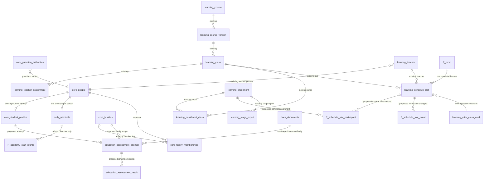

# P0.1 Minimal Target ERD

**Legend:** existing Canonical objects are unprefixed; names marked `P_` are proposed additions and do not exist on current main. This ERD is conceptual and is not SQL.

## Existing vs proposed object inventory

| Object | Status | Why it exists |
|---|---|---|
| `core.people`, `core.student_profiles`, `core.families`, `core.family_memberships`, `core.guardian_authorities` | EXISTING | Canonical identity and family authority |
| `auth.principals`, `auth.context_exchange_tickets`, `auth.session_contexts` | EXISTING | Single Principal and trusted context lifecycle |
| `learning.course`, `course_version`, `class`, `enrollment`, `teacher`, `teacher_assignment`, `enrollment_class` | EXISTING | Catalogue, course registration, roster and teachers |
| `learning.schedule_slot`, `attendance_record`, `attendance_correction` | EXISTING | Timetable and attendance |
| `learning.after_class_card`, `publication`, `stage_report` | EXISTING | Teacher feedback and publication |
| `education.academic_record`, `score_record`, `language_test` | EXISTING | Current education facts; insufficient for full instrument contracts |
| `docs.documents`, consent and audit | EXISTING | Evidence, authority, access decisions |
| `P_learning.academy_staff_grants` | PROPOSED | Only explicit Academy Admin/Founder capability |
| `P_learning.room` | PROPOSED | Stable room identity/capacity; replaces free-text collision semantics |
| `P_learning.schedule_slot_participant` | PROPOSED | Per-student slot reservation and teacher-assigned Hybrid mode |
| `P_learning.schedule_slot_event` | PROPOSED | Immutable mode/room/time change history |
| `P_education.assessment_attempt` | PROPOSED | Instrument/version/source/review/evidence lifecycle |
| `P_education.assessment_result` | PROPOSED | One explicit scale/dimension/value per attempt |

The ERD intentionally contains no tenant, organization, franchise, duplicate student, duplicate teacher, workspace-session, package-hour, payment, refund or settlement object.
