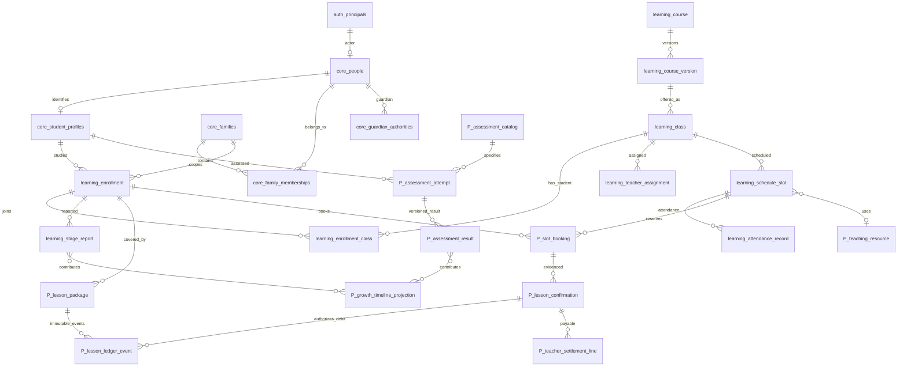

# Academic Studio V2.1 target ERD

Status: **PROPOSED target**, anchored to verified formal Canonical 0001–0037. Names prefixed `P_` are conceptual, not existing tables or reserved migration names. Foreign keys and access paths require separate SQL review.

Existing Canonical entities are represented by their exact schema/table names with dots replaced by underscores only for Mermaid syntax. `P_growth_timeline_projection` should be a read projection or view, not an independent student master. `P_teacher_settlement_line` is evidence for a separate authorised settlement authority; it is not a payroll/payment ledger.

## Required invariants

- A booking changes slot allocation, never a package balance.
- A lesson debit requires a teacher-confirmed delivery fact, approved attendance policy, matching student/enrollment/package and an idempotent event key.
- The ledger is append-only; correction, make-up and refund are compensating events linked to the original event. No UPDATE/DELETE of history.
- Exclusion constraints or serializable transactions must prevent teacher, student and physical-room overlap, including concurrent inserts. Existing 0022 only excludes teacher overlap.
- Assessment attempts preserve instrument, edition, scale, source and evidence; growth timeline shows provenance and the viewer's current authorisation.
