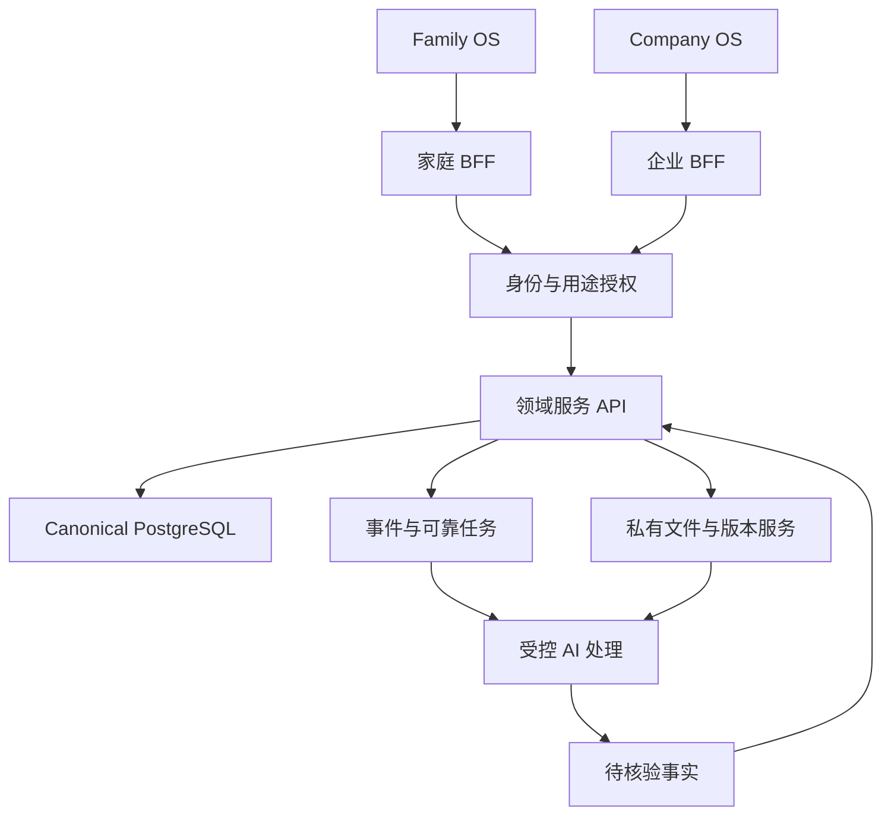
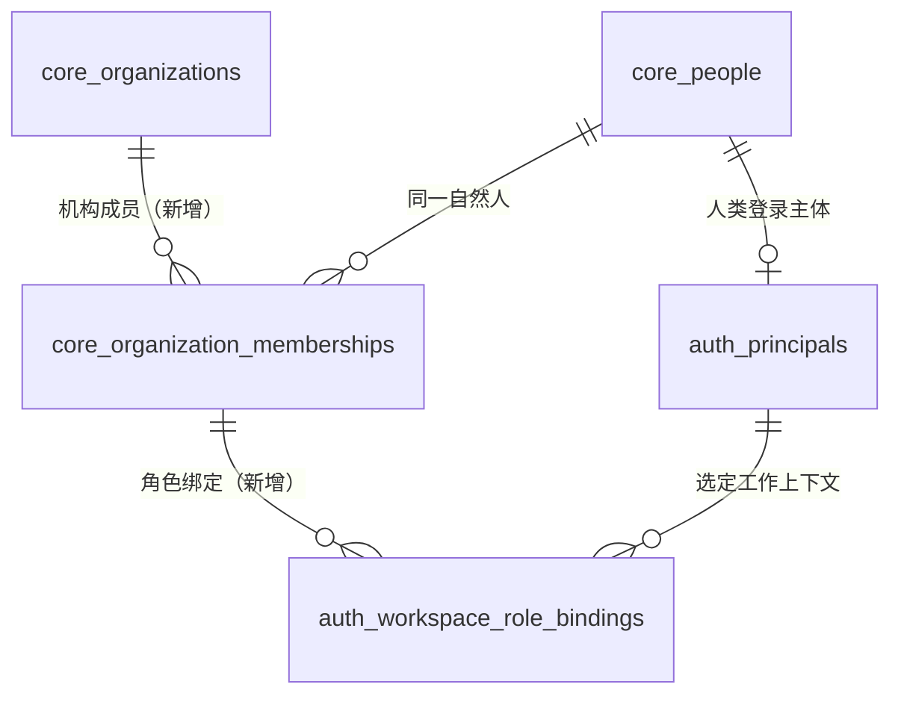
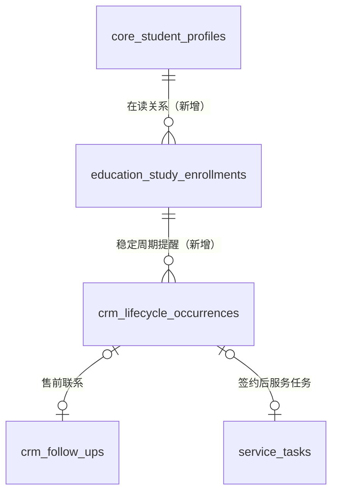
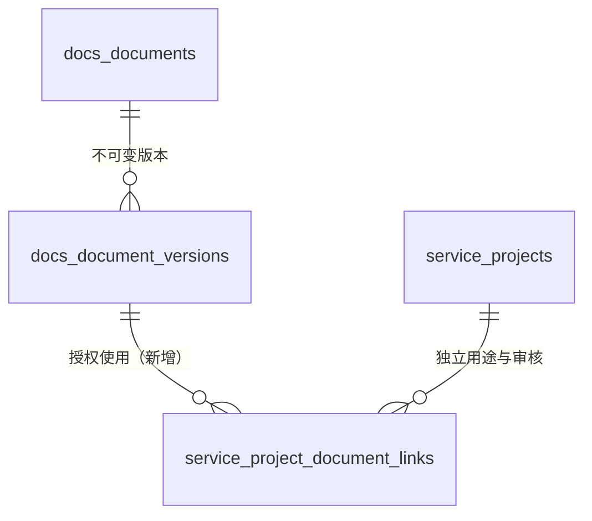

# Phoenix Nova™｜Enterprise Unified Architecture V3.0

**核验日期：2026-11-20，Asia/Shanghai。**  
**状态：可审查的架构与 P1 开发候选；不是生产上线证明。**  
**工作项：[Issue #75](https://github.com/yvettfang-netizen/phoenix/issues/75)。**  
**核验主线：`9db147ac3a5d135d50b90bfea5a7316ce747d90b`。**

本报告执行本轮 Founder 指令：Family OS + Company OS；优先复用 Canonical PostgreSQL；保留 Growth OS 的人的能力成长语义。正文按要求分成七部分。完整逐表清单见 [DATABASE_REUSE_MATRIX.md](DATABASE_REUSE_MATRIX.md)，接口与状态机见 [API_CONTRACTS.md](API_CONTRACTS.md)，实际执行证据见 [VALIDATION.md](VALIDATION.md)。

## 第一部分：Founder Executive Decision Brief

### 1.1 核心判断

现有数据库基础足以承接双 OS 升级。需要补齐的是**多组织多身份的工作上下文、跨角色业务交接、材料的授权复用、长期跟进调度，以及现有模块的真实运行接线**。重新创建 Company OS 主库、再造学生主档或整体改名 schema 都没有必要。

当前最重要的六项裁决：

1. **两个产品门户，共用服务端和主数据。** Family OS 服务家庭/学生；Company OS 内含 Founder、Staff、Partner 工作区。两者都是客户端，分别经 BFF/API 访问 Phoenix Core。Company OS 本身不是 Family OS 的数据库或后端。
2. **组织归属、商业来源、交付责任、资料访问分别管理。** “某渠道推荐的学生”只能证明来源，不能推导出四年后的联系方式、成绩单或家庭私档读取权。
3. **一人多角色需要身份兼容工程。** 当前 `auth.principals.person_id` 唯一，`principal_kind` 单值，现有上下文按 FAMILY/ADVISOR/CHANNEL/STAFF 固定绑定；不能只增加一个页面切换按钮或新角色表就宣布完成。
4. **沿用现有服务工作台。** PR #65 已把服务工作台相关代码合入 main。`0038/0039` 的 SQL 虽在主线目录树中，仍是 forward candidates；源码合并与数据库安装必须分开认定。
5. **本科之后的联系任务先归 CRM。** 没有硕士合同和项目开通依据时，复用 `crm.follow_ups`。新硕士服务真正成立后再创建新的 `service.projects`，两次服务共用同一学生身份。
6. **保留现有学习闭环再切换持久化。** ASKWISE 主线仍存在 SQLite 实现；#68 是未合并的退役候选，Education→ASKWISE 运行契约仍为 RESERVED。退役旧库不等于已迁移学习记录。

这些判断来自当前固定源码及 PR 状态，不是根据历史设计表名推测。核心证据：[主线](https://github.com/yvettfang-netizen/phoenix/tree/9db147ac3a5d135d50b90bfea5a7316ce747d90b)、[PR #65](https://github.com/yvettfang-netizen/phoenix/pull/65)、[PR #68](https://github.com/yvettfang-netizen/phoenix/pull/68)、[身份上下文](https://github.com/yvettfang-netizen/phoenix/blob/9db147ac3a5d135d50b90bfea5a7316ce747d90b/database/canonical/migrations/0022_learning_core.sql)。

### 1.2 本轮已确定、不应重做的内容

| 事项 | 裁决 |
|---|---|
| 产品命名 | Family OS + Company OS；Founder Dashboard 为 Company OS 内部角色视图 |
| 唯一身份 | 沿用 `core.people`、`core.student_profiles`、`core.families` 和已有公开 ID 映射 |
| 数据库业务域 | 保留 `core/auth/consent/crm/service/education/learning/docs/audit/integration/operations_ref` 等现有域 |
| Growth OS | 保留能力、证据、成长审核语义；不改名 Company OS，不用成长等级授予管理权限 |
| 业务主事实 | CRM 管获客/客户关系，Service 管签约后的交付，Education 管教育事实与申请，Learning 管课程教学 |
| 对象文件 | 原文件继续在私有对象存储；Canonical 管版本、元数据、授权和证据链接，不把二进制全塞进数据库 |
| 外部事实 | 真实支付、退款、院校回执由对应权威来源形成；Canonical 保存经过验证的引用和业务状态，不虚构原始外部事实 |
| 公共导航 | 首页｜教育｜身份｜健康｜财富｜洞察；沿用当前正式品牌资产与组件 |

### 1.3 历史依据核验

| 资料 | 本轮读取情况 | 使用边界 |
|---|---|---|
| FOUR_PORTALS_UNIFIED_ARCHITECTURE_V1.1.md | 全文 586 行已读 | 原状态为 DESIGN CANDIDATE。四角色可归入两个 OS；不能当成上线证明 |
| Phoenix_Dual_OS_SQL_Foundation_V1.0.md | 全文 1531 行已读 | 旧 Dual 是 Family + Growth；旧表名为设计映射来源，不再造 `family_os.people` |
| Phoenix_Nova_Enterprise_Baseline_V2.0.md | 全文 140 行已读 | 企业定位与业务边界保留；本轮新导航覆盖旧导航冲突 |
| 凤启学苑_鳌鱼与ASKWISE统一接入_执行指令_V1.0.md | 全文 247 行已读 | 保留课程任务→诊断→提示→重试→证据→学苑摘要→鳌鱼反馈的责任划分 |
| 《Family OS × 大学申请 × 凤启学苑 × ASKWISE 统一架构评估》完整原文 | **UNVERIFIED：未定位到完整原件** | 不声称已读；已有可核验源码与其余资料足以推进本轮受限候选 |
| V5/V6 完整视觉审批记录 | **UNVERIFIED：未获得完整审批清单** | 本轮复用源码中的现有 Logo、颜色、字体；不重新生成品牌资产 |

历史材料的私人原件、价格和环境细节不复制进此公开工程报告。Little Tail 仅作为 Founder 描述的“机构编码 + 个人账户 + 清晰角色”体验参考，本轮未取得其源码，不能称已复用其认证实现。

## 第二部分：Target Architecture V3.0

### 2.1 双门户及数据流



图为目标结构，不表示这些接线均已运行。AI 的文件读取必须由同一授权服务发放用途受限的读取能力；图中的连线不是开放对象存储权限。已核验事实的回写要经人工批准和领域 API。优先采用现有模块化服务，只有容量或部署边界有证据要求时再拆独立服务。

### 2.2 Company OS 的三个工作区

| 工作区 | 首页重点 | 数据边界 |
|---|---|---|
| Founder | 观澜台、今日三件事、交付逾期、渠道转化、待审批事项、经营摘要、九灵任务状态 | 经营汇总权限与个人私档读取权限分离；每项摘要显示来源和更新时间 |
| Staff | 我的客户/项目、待审核材料、交接请求、截止日期、顾问协作 | 当前组织成员关系、角色能力和具体项目分派共同限定范围 |
| Partner | 我的机构、邀请学生、推荐跟踪、获授权进度、跟进任务、合同范围内结算 | 管理下级伙伴不继承下级全部学生资料；原推荐关系不自动解锁未来材料 |

九灵任务状态采用现有任务执行系统的只读、带来源摘要；本轮不新建第二份代理执行台账，也不把模型自报“完成”当作业务完成。

### 2.3 身份与组织模型

机构编码用于定位机构，不是密码、邀请凭据或授权。首期可复用 `integration.public_ids` 的 ORGANIZATION 公开 ID；若需易输入的短码，在现有组织的受控扩展中增加唯一、不复用的别名。`core.organization_identifiers` 保存官方证照摘要，不适合放登录短码。

每人拥有自己的登录身份，外部可信认证绑定既有 `auth.principals` 和 `core.people`。优先复用现有身份提供方和账户停用/会话撤销机制；只有明确采用密码认证时才按认证组件保存加盐安全哈希，不在组织或学生表保存密码。员工/伙伴管理权限可要求 MFA；不要用共享机构密码。

新工作上下文必须含服务端核验的 `principal`、选中的组织/成员关系、角色绑定、用途、有效期、授权版本；浏览器只能提交候选工作区 ID，不能自报角色、家庭或组织即获得权限。

**授权决策应是交集：**登录有效 ∩ 当前工作区有效 ∩ 角色允许操作 ∩ 当前组织关系有效 ∩ 资源明确分派/共享 ∩ 必要同意与有效期满足 ∩ 数据用途允许。任一失败即拒绝，不能将多个角色的权利并成一个超级身份。

| 操作 | 学生本人 | 有效监护/受权家长 | 分配顾问 | 原推荐伙伴 | 总部/Founder |
|---|---|---|---|---|---|
| 个人档案/材料 | 本人有效范围 | 按被授权成员及资料类别 | 按项目、用途、有效期 | 默认不开放，需另外明确授权 | 经营角色不自动开放 |
| 客户商业来源 | 不作为可编辑主事实 | 不作为可编辑主事实 | 按岗位最小范围 | 自己的受限来源摘要 | 获授权经营范围 |
| 申请进度 | 已发布的本人进度 | 被授权进度 | 被分派的业务进度 | 被批准的进度摘要 | 管理摘要及必要下钻 |
| 未来硕士联系名单 | 本人的偏好与待办 | 不自动代成年子女授权 | 当前负责的记录 | 总部派发且当前联系资格有效 | 受限生成名单、审核与分派 |
| 佣金/结算 | 无默认权限 | 无默认权限 | 无默认权限 | 合同约定的本机构摘要 | 相应经营/财务权限 |

组织的上下级管理关系应有有效期、委托边界和撤销链；组织树只服务管理与归属。选择需要严格层级的关系类型后，加入防环和合法父级约束；不能把所有现有 PARTNER/REFERRER 关系当作单一行政树。

### 2.4 资料到交付闭环

1. 学生通过邀请/登录进入 Family OS；邀请码绑定拟加入关系及期限，不自动匹配同名学生。
2. 服务端验证本人/监护/用途，创建上传会话；原件进入私有隔离区，完成类型/大小/恶意文件检查后登记 `docs.document_versions`。
3. 已有版本允许在获授权的新项目中引用。校验文件权限、保留期及本次使用范围；新项目审核状态独立。
4. 受控 AI 生成带文档页码/字段来源的待核验事实。顾问逐项接受/修正/拒绝，通过既有领域写接口追加事实。
5. CRM 跟进与 Service Project 交付分别落在既有任务体系；交接记录提出人、接收人、范围、原因、接受时间、版本和超时处理。
6. Company OS 处理；Family OS 只显示被批准发布、与本人相关的状态。所有更改有审计、幂等键和版本冲突处理。

交接采用“提出→接受/拒绝→原负责人结束/新负责人生效”的原子流程；接受前原负责人仍承担责任。账号离职或撤权不能等待交接才停权：立即停权，未交付责任返回总部待处理队列。

### 2.5 长期成长与硕士跟进

例：真实入学日 2027-09-01、预计毕业日 2031-06-30。大二末核验可以配置为入学后约 21 个月；硕士意向联系可用实际学年结束/暑期锚点，或无日历时采用经审核的毕业前约 13 个月模板；大四申请联系再根据目标地区和申请季设置。这些是**示例规则**，不是所有国家、学校的招生时间事实。

优先用真实学年节点；学制、入学季、休学、转学、延期毕业会改变未来日期。日期未知时生成信息核验，不编造精确毕业时间。日期使用校历所在地的 civil date，发送时再由明确时区解析，避免 UTC 午夜跨日。

业务状态：总部候选名单→总部核验/分派→渠道领取→联系结果→需顾问支持→新商机/合同→新 Service Project。原渠道仅是建议接收者；不合格、停用、过期或未受权时回总部。

**防重复规则：**稳定业务键为 `(study_enrollment_id, journey_cycle_id, rule_key)`。毕业日、提醒日期、规则版本、自动推算的目标入学年都不放进唯一键。延期只重算同一未完成提醒；已完成/取消的记录不自动重开。真正新一轮申请由明确的新 cycle 创建。

纯计算器输出不等于调度系统已运行。落地还需要数据库唯一约束、版本检查、事务内任务关联与 outbox，以及发送前再次检查退订/授权。两个 worker 得到相同结果不构成数据库“只执行一次”的证明。

### 2.6 AI 资料服务及成本

建议首期采用**可替换的商业 API 适配器 + 本地文档预处理 + 人工核验**，先以合成/获明确许可的样本评估，按证据再决定是否私有部署。选型比较如下，属于工程评估建议，不是特定模型效果保证：

| 方式 | 优点 | 成本与运维 | 适合当前的使用方式 |
|---|---|---|---|
| 商业模型 API | 接入快，便于替换和对照评测 | 按实际用量、存储/工具及重试计费；需评估供应商留存与地区安排 | 小规模受控提取、复杂文档兜底 |
| 私有部署 | 能细化数据处理位置和模型版本 | 算力、容量、补丁、监控、评测都由团队承担 | 用量与数据约束足以证明投入价值后 |
| 混合 | OCR/清洗/规则本地处理，复杂推理受控路由 | 接线和质量评估更复杂，需避免重复处理 | 首期保留适配层，分阶段引入 |

预算模型：月成本 = OCR 页数成本 + 输入/输出 token 成本 + 文件/检索/存储成本 + 重试成本 + 人工审核成本 + 运维摊销。记录每文档版本的实际用量、延迟和接受率；设置机构预算、单任务最大重试、并发限制和异常停止。不要把缓存命中或本地部署自动视为“免费”。

平台端可以统一承担模型 API 费用，学生和代理使用 Phoenix 账户即可。OpenAI 官方说明 API 费用与 ChatGPT 订阅分开；不能把一份 ChatGPT 个人会员当作全系统后端调用授权。[官方说明](https://help.openai.com/en/articles/6950777-what-is-chatgpt-plus)

输出分类固定为：`VERIFIED_FACT` 已核验事实、`EXTRACTED_PENDING` 提取待核验、`INFERENCE` 推断、`RECOMMENDATION` 建议。提取事实保存来源文件版本/校验和/页码或片段/解析模型与提示版本/人工审查；模型不能直接修改主档或执行任意 SQL。

授权检查必须覆盖入队、读取文件、向供应商发送、结果保存/展示、人工批准写档。文档内容是不可信数据，里面的指令不得影响工具调用或权限。撤权后取消尚未发出的请求，隔离后续结果并清理派生缓存；已经发给外部服务的数据不能声称瞬间收回。OpenAI 的“不默认用于训练”和数据留存是不同控制，具体端点、文件删除及适用留存安排需要按官方说明核对。[数据控制](https://developers.openai.com/api/docs/guides/your-data)

缓存/向量查询必须绑定主体、资料版本、用途、授权版本和可见范围；不能因文件哈希相同向另一家庭透露文件存在，也不能把多个客户的文档放入无隔离的共享检索集合。

### 2.7 Academy、ASKWISE、鳌鱼和 Growth OS

Academy 管课程、教师、课节、课后任务和教学摘要；ASKWISE 管 session/attempt/diagnosis/hint/retry/evidence；鳌鱼只展示已确认事件；Core 管身份、授权和权益。Family OS 展示已发布的学习摘要，Company OS 为教师/顾问提供岗位视图。独立 ASKWISE 使用路径保留，不新增强制课程购买前提。

保留已有 `AcademyToAskwiseAssignmentV1` / `AskwiseToAcademyLearningSummaryV1` 的语义；连接 source event、student、task、contract version，旧摘要不得覆盖新结果；换账号清缓存，重复证据不重复庆祝。Growth OS 如记录能力证据，只保存引用及其本领域审核，不复制全部 ASKWISE 学习事实或映射成系统权限。

## 第三部分：Reuse & Gap Analysis

### 3.1 当前状态按证据分层

| 模块 | 用户要求的状态分类 | 当前可证明的事实 | 不能外推的事实 |
|---|---|---|---|
| Canonical 0001–0037 | 已合并但尚未完成生产验证 | 37 个正式文件；源码可复核；#74 附 11/19 隔离非生产升级报告 | 本轮未直接连接该环境；不是生产验收 |
| Service Project 基础 | 已合并但尚未完成生产验证 | 0028/0034/0035，含责任、状态、交付版本及审计 | 不等于公司完整运营台已开放 |
| Workbench UI/API 与 0038/0039 | 代码已合入；迁移仍属开发候选 | #65 已合并；main 中有候选 SQL 和 UI/BFF | 不能把候选 SQL 写成已安装正式迁移 |
| Company 多组织/多角色工作区 | 业务运行能力尚未实现；本轮骨架属候选 | 页面方案和受控本地预览 | 机构登录、Partner ACL、Founder 全局投影未完成 |
| Education 申请与学术记录 | 已合并但尚未完成生产验证 | `education.applications`、学校专业、学术记录已有 | #74 问卷/报告候选不是全部大学申请模块 |
| 教育问卷/报告 Canonical 持久化 | 开发候选/未合并 PR | #74 Draft，确切 head 的七个工作流成功 | 不代表候选 SQL 已部署或真实付款/身份已验收 |
| ASKWISE | 已合并代码，持久化统一待完成 | 学习引擎和 SQLite 路径仍在 main；交接契约 RESERVED | 不能声称 Canonical 已承接学习记录 |
| 凤启学苑 | 现有课程表可复用；独立应用运行情况 UNVERIFIED | main 有 learning 核心与历史接入契约 | 未在 main 定位独立可运行 Academy 工程；不等于用户其他工作区不存在 |
| 旧数据库退役 | 开发候选/未合并 PR | #68 Draft；历史确切 head 有一个网站工作流失败 | 不能说旧库已全删、无记录或已迁移 |
| 真实上传、AI 提取、自动长期派发 | 完整闭环尚未实现 | Workbench 有受限合成上传；本轮有规则计算候选 | 不等于正式对象存储接入、AI 读取或定时任务已运行 |

本轮未获得足以把任何新能力标为“已合并且已完成当前生产运行验证”的证据。状态同时记录源码、环境和验证级别，避免只用一个绿色 PASS 混淆它们。

### 3.2 关键 PR 的核对

| PR | 本次观察 | 集成动作 |
|---|---|---|
| #65 | 2026-11-09 合并，`cafccf715825e1f701119df80f548a1600bbfacd` | 复用已有代码，勿再因 #59/#60 开着而重复开发 |
| #59 / #60 | 历史 Draft | 逐文件比对剩余差异；不盲目再合整条分支 |
| #66 | Family Center 集成 Draft | 与当前页面/客户桥接逐项核对 |
| #68 | Draft；head `9ce4845…` 的 Website PR checks 在高危依赖门禁失败 | 退休旧持久化前补齐功能替代与数据依据；本轮新分支的依赖审计另见 VALIDATION，不能改写历史结果 |
| #71 | V6 首页候选仍 open，本次查询 `mergeable=false` | 需要处理现有冲突；不可用它覆盖本轮导航或把候选的腾讯发布描述当作当前 main 来源 |
| #74 | Draft；head `1366b53…` 七个工作流成功 | 复用证据/候选能力，保持具体 SQL 安装与真实身份联调独立验证 |

`#74` 的脱敏报告写明隔离非生产库 35→37、93 张表、83 条 RLS 策略、PG16/17 合成与恢复验证；真实身份、真实支付、生产切换及旧库退役仍 HOLD。本轮读取了报告，未独立重连环境验证这些数字。[固定报告来源](https://github.com/yvettfang-netizen/phoenix/blob/1366b53f662082098c2f2673e9ee4be6f433b261/docs/database/education-assessment-report-20261118/CONTROLLED_EVIDENCE_AND_NONPROD_DEPLOYMENT_20261119.md)

### 3.3 必须优先解决的具体缺口

- `auth.principals` 单一类型与多工作区角色之间的兼容；当前人类上下文要求 family_id，不能拿任意家庭冒充全公司汇总上下文。
- `auth.register_external_identity` 的旧类型限制与 TEACHER/SUPERVISOR 之间的接缝；有教师表不等于教师 SSO 已完成。
- 多机构成员、委托管理、角色有效期以及跨组织资源许可；关系表不具备这些全部语义。
- `service.workbench_materials` 用 `version_id` 单列主键，一个版本只能绑定一个项目；本科→硕士引用同一版本需要受控扩展。
- `learning.enrollment` 是凤启课程报名，不能用作大学四年在读记录；需要小型 `education.study_enrollments` 扩展。
- `crm.follow_ups` 已有任务，但没有完整生命周期规则、去重 occurrence、调度/发送队列和撤权重检。
- 普通后端启动入口未装配 Workbench；main 未包含历史独立 staging main 文件。候选部署接线需明确修复，不通过关闭安全门禁来演示可用。
- `database/canonical/README.md` 中 0036/0037 “尚未合并”的叙述已过时；本报告提供时间戳基线，不改历史迁移或原证据文件。

## 第四部分：Database Evolution Plan

### 4.1 原则与迁移次序

本次 P1 **不新增正式或候选的权限 DDL**。原因是审查已发现旧 principal/context 契约冲突，必须先实现版本化兼容，再为真实账户开放 SQL。下面是具体、可执行拆分的迁移设计，不是已验证可运行的生产 SQL。

新序号由 Jimson 在最新 main 和所有已批准候选中统一分配。不得直接把新工作命名为 0038；本次确认 main 候选有 0038/0039，历史分支还出现 0040/0041。采用命名工作包先评审，不自动重编号旧候选。

### 4.2 最小增量实体与约束

下列名称为提议，落地时与现有契约最终对齐；不创建新的 person/student/client/project 主实体。

| 工作包 | 新增/扩展的最小对象 | 关键约束与索引 | 写入/读取策略 |
|---|---|---|---|
| A 组织与上下文 | `core.organization_memberships`；`auth.workspace_role_bindings`；版本化工作上下文 | 既有 organization/person/principal FK；有效期间；撤权；同类有效成员/角色防重叠；按 principal/org/status 索引 | 仅受控邀请/管理 API 创建；默认无直接表访问；组织码仅定位 |
| B 机构可用性 | 复用 ORGANIZATION public ID；必要时组织短码和工作区启停扩展 | 短码规范化、唯一、不得自动转授；停用使成员工作上下文失效 | 不把证照摘要表改成密码表；不让机构管理员授予总部/Founder 权限 |
| C 大学在读 | `education.study_enrollments`，配套不可变变更事件 | UUIDv7；既有 student/family FK及一致性校验；学校/专业/证据版本 FK；真实入学、预计/实际毕业、校历、状态、revision | 当前投影可修订，历史事实追加；不更改 `academic_record` 历史行或 Phoenix 课程报名语义 |
| D 跟进规则 | 稳定 rule_key + 不可变版本；`crm.lifecycle_occurrences` | unique(enrollment_id, cycle_id, rule_key)；revision；due/status 索引；现有 follow_up 或 task 的真实 FK及互斥链接 | 未签约指向 CRM；已有新项目才指向 service.tasks；总部核验后派发 |
| E 可靠执行 | 在现有 integration 下扩展受控 outbox（确认不存在等价实现后） | unique(event_id)、幂等 command_key、租约、next_attempt_at、重试次数、死信状态；不含资料正文 | 与业务写入同事务；消费者重试幂等；发送前再次授权 |
| F 材料复用 | `service.project_document_links` 或等价受控关联扩展 | project+document_version+用途唯一；subject/family/project一致；每个链接独立审核/撤销 | 保留 docs 原件和版本；旧工作台接口保留、通过 v2 逐步采用新关联 |
| G AI 候选 | `docs.extraction_jobs`、可审查的候选事实/复核记录 | version/purpose/parser/model/prompt/schema/grant_epoch 幂等；来源页码；reviewer；job/fact版本 | AI 无主档写权限；人工确认再调用已有 education/crm API |

逐包需要新建表时都明确 FK、唯一/排他约束、业务状态、RLS、ACL、审计和 rollback/补偿；不能仅在 JSON 字段里埋可绕过的组织/家庭关系。多家庭关联必须由后端与数据库共同核验；单个 FK 存在性不证明 subject 属于该 family。

### 4.2.1 核心关系 ERD

以下是范围明确的逻辑 ERD，采用下划线表示 schema 与表名之间的点；标注“新增”的节点仍是设计候选，不是当前已建表。

**组织与同一自然人的多工作区。** `organization_memberships` 和 `workspace_role_bindings` 新增；其余沿用现有主实体。角色绑定中的 principal 与 membership 必须属于同一个人，不能只靠两条独立 FK。



此图仅表示 Company 人类成员；非自然人的 SERVICE principal 不套用图中的 person 基数。角色绑定是能力依据，仍需额外通过每条资源的授权检查。

**从大学在读到下一次服务。** `study_enrollments` 与 `lifecycle_occurrences` 新增；学生、CRM 跟进和 service task 均复用。



审核队列中的 occurrence 可暂不关联任务；正式派发后必须关联一条真实任务。follow_up 与 service_task 链接互斥，分别用唯一索引约束；从售前转交付按审计交接处理，不让两条任务同时承担同一次联系。

**不可变文件版本跨项目使用。** 新关联按项目分别审核，避免复制原件或继承旧项目的批准。



### 4.3 身份兼容迁移的实现边界

保留既有 `principal_id/person_id` 与旧 `principal_kind` 语义，不删除 person 唯一约束来创建多个相同自然人。新增工作区角色关联是权限信息，不是第二套登录主数据。

新增 `/v1/me/workspaces` 与工作上下文 v2，明确选中的成员关系、角色、用途、期限和撤权版本。旧 API 继续用原校验；v2 的领域接口通过新授权 helper 逐端点接入，不能冒用另一人的 ADVISOR principal、把浏览器角色改成 SERVICE、或放宽旧函数接受所有角色。对确需服务代理写入的路径，保存已核验 delegated actor 与权限决策，并在同一事务重新验证。

新上下文与连接池的生命周期、一次性票据、session 切换、clear_context/finally 清理必须测试。组织列表/经营汇总只投影授权资源，不授予裸表查询权；混合身份切换清理前端缓存和旧请求，不沿用上个身份的资料。

### 4.4 并发、任务和文件迁移

生命周期事务应先锁定或原子 upsert 稳定 occurrence，验证 expected revision，再建立/修改唯一现有任务关联并写 outbox。相同幂等键不同 payload 返回冲突。毕业日期变化、规则不适用、退订、合同从无到有，都需识别旧任务并产生修订/停止/交接，不能另建重复跟进。

`crm.follow_ups.assigned_principal_id` 非空，且 target 仅 LEAD/DEAL/CLIENT。因此“总部待分派”不能用 NULL 或假学生项目实现：首期指定有效总部负责人，或在 occurrence 审核队列中等待后再创建 follow_up。联系策略必须有当前有效依据；过期不推送、不暴露联系字段。

材料关联迁移保留旧 `workbench_materials` 合约，不直接删除其主键或重写 0038。新增关联先回填可核验旧绑定、比对数量/范围、启用 v2 读取，再切换写入；旧项目审核通过不等于新项目审核通过。客户引用既有文档时仍可因用途、保留期或撤销被拒绝。

### 4.5 RLS 与回滚

新增受保护表默认拒绝，撤销 PUBLIC/应用直接表权限，明确受控函数执行许可；涉及 SECURITY DEFINER 时固定 search_path、限定所有者权限、检查授权上下文和注入面。按实际模式测试 `USING` 和 `WITH CHECK`，并以真实受限 LOGIN 验证；不能使用超级用户绕过 RLS 后宣布隔离通过。PostgreSQL 明确超级用户和 BYPASSRLS 角色可绕过行安全，表拥有者通常也可绕过，需相应设计 FORCE RLS 和权限边界。[PostgreSQL 17 行安全文档](https://www.postgresql.org/docs/17/ddl-rowsecurity.html)

PG16/17 都执行 fresh、从现有 0037 升级、重复运行校验、checksum 漂移拒绝、失败事务回滚、备份恢复，以及跨家庭/跨机构/过期/撤权/伪造上下文/并发/应用重启测试。保护分支的 0035 检查只覆盖它声明的基线子集，新增 SQL 需要自己的精确候选测试，不能借历史绿灯。

回滚优先停用新入口/worker、恢复兼容应用版本并保留新增证据；有接受新写入后不靠 DROP TABLE 回滚。恢复到备份只在已确认的恢复目标执行，不能覆盖仍在接单的业务库。每次版本切换留 rollback SHA、迁移账本和恢复结果。

## 第五部分：UI / UX Design System

### 5.1 品牌与公共入口

沿用 `BrandMark` 和当前资源 `/brand/official/v3/phoenix-nova-bilingual-b@2x.png`；颜色和字体从现有 `app/globals.css` 读取，不新建另一套 token。当前可复用色包括深海青 `#003b46`、墨青 `#123f48`、青灰 `#8caea4`、香槟金 `#c99b50`、象牙白 `#f8f6f1`、海军蓝 `#0d1b2a`。

公共主导航只保留六项。Family OS/Company OS 是账户入口及登录后的工作区，不占据新增一排业务导航。现有财富入口经 `navigationHref()` 到批准的 Wealth 域名，保留该路由，不凭路径名猜成主站锚点。关于、服务、探索和支持在现有页脚体系中保留。

### 5.2 页面清单与建设次序

| 门户/工作区 | 页面 | 复用来源及新工作 |
|---|---|---|
| Family OS | 首页、家庭成员、学生成长、服务项目、申请列表/详情、材料库、学习、消息、授权与隐私 | 复用 family-center、my-services、已有 docs/education/learning 投影；补跨项目文档引用和生命周期时间线 |
| Company 通用 | 登录、机构定位、允许工作区选择、我的账户、安全/退出 | 复用认证提供方；新增服务端工作区上下文，不用浏览器下拉框模拟权限 |
| Founder | 观澜台、今日三件事、经营摘要、渠道/交付预警、待审批、九灵状态 | 接只读受限投影，显示来源/as_of；无真实数据时明确空态 |
| Staff | 我的工作、客户、项目、交接箱、审核材料、学校申请、任务/日历 | 复用 service 工作台领域能力；按任务/责任组织信息 |
| Partner | 机构成员、邀请、推荐客户、获授权进度、跟进箱、下级伙伴、结算摘要 | 新建最小伙伴投影，按授权显示字段和动作；不复制员工后台 |
| 管理 | 组织/成员、角色委托、服务模板、跟进规则、授权/审计 | 限管理角色；规则版本有审批与生效时间 |

列表/详情统一显示负责人、状态、截止日、来源时间、同步状态。未知数据用“待确认”，不能用 0；权限不足、空列表、加载失败、材料需补正、版本冲突、授权过期、任务已被他人领取分别有可理解状态。写入冲突提示刷新并比较，不静默覆盖；离线草稿需明确未提交，不能伪装同步完成。

### 5.3 本轮 P1 已实现边界

本轮仅改变共享导航、增加 `/{locale}/company-os` 本地设计骨架，以及开发用规则计算器。Company 页面显示三个角色的拟定职责，沿用品牌，并链接已有 `/my-services` 候选；没有新增真实账户、客户数据请求、经营数字或角色授权。

页面要求开发模式、已有 workbench/synthetic 开关、非真实 customer-bridge 模式与 loopback Host；生产默认不开放。**Host 是请求头，不是身份验证或 TCP 来源证明**，预览还必须显式绑定 `127.0.0.1`，不使用公开隧道。后续真实 Company 页面必须接入可信账户与授权 API，不能延用这个预览门禁作为认证。

## 第六部分：Codex Implementation Plan

### 6.1 PR 工作包

| PR 包 | 依赖与范围 | 最低验收 | 当前状态 |
|---|---|---|---|
| A 本轮架构/P1 候选 | 精确 main；导航、Company 骨架、生命周期纯计算、只读核验、完整交接 | 构建/类型/现有回归；预览关态；迁移原字节不变；无生产动作 | 见 VALIDATION |
| B 身份与组织 v2 | A 的权限契约；机构成员/角色/上下文，选一个只读岗位接口先接通 | 同人三角色隔离、跨家庭/组织、离职/撤权、角色切换、旧 API 兼容、PG16/17 | 待实施 |
| C 服务工作台运行接线 | B；确认 0038/0039 候选与现有部署账本，补受控 staging 入口 | 真实受控身份→BFF→API→Canonical→审计；保持失败关闭与无敏感缓存 | 待实施 |
| D 伙伴最小闭环 | B+C；机构邀请/受限名单/总部交接/授权状态摘要 | A/B 伙伴隔离，上级不自动下钻；同名学生待去重；成员停用即时失效 | 待实施 |
| E 文档与 AI | B+C；私有对象存储、版本复用、提取队列/人工确认 | 版本一致、撤权各阶段阻断、跨项目审核独立、模型无事实直写、来源可追溯 | 待实施 |
| F 学生成长与跟进 | B+D；study enrollment/规则/occurrence/outbox 及纯计算器接线 | 延期不重复、并发仅一关联、退订不发送、总部派发、签约后新项目 | 计算器候选已写；持久化/worker 待实施 |
| G Academy/ASKWISE | B；现有学习契约和已确认源码；协调 #68/#74 | 首答→Hint→Retry→Evidence→摘要→刷新恢复；权益撤销、事件幂等、学习记录对账 | 待实施 |
| H 受控真实验收与发布 | B–G 按业务切片交付，不要求同一日全开 | 环境回执、权限负例、恢复、监控告警、Owner 审查、Founder 生产批准 | 待执行 |

不先堆所有机构/财务/人事页面。第一条真实业务验收线应是：**一组总部账户 + 两个相互隔离的伙伴机构 + 两个合成家庭 → 邀请 → 上传 → 顾问复核 → 伙伴只见批准摘要 → 总部跟进派发**。通过后再扩渠道层级、通知渠道和更多教育路径。

### 6.2 契约与兼容要求

既有 `/api/service-workbench/*`、`/{locale}/my-services`、旧 principal/ticket 接口不在本轮改名。新能力通过明确的 v2 工作区契约接入。读响应含来源 revision/as_of；写请求有幂等键和 expectedRevision。具体 API、字段信任边界、错误和事件见 [API_CONTRACTS.md](API_CONTRACTS.md)。

每包 PR 写明 base/head、涉及文件、依赖迁移及 hash、具体命令与 exit code、真实/合成环境、未验事项、回退方式。不能把候选 UI、mock 数据或单元测试算成正式端到端验收。工期由 Jimson 根据身份提供方、实际部署和人力核验后填入，不给未经确认的“今晚全上线”承诺。

## 第七部分：Jimson Integration Handover

### 7.1 先确认交接对象

接收的是同一 repo 内的候选分支、审查文档、接口/迁移设计和测试证据。**没有一份可以把“跑完的数据库”直接合并进生产的转储。** 非生产整合应重放经过批准的相同迁移，核对账本和 hash，再接应用；不能合并两个不明来源的数据库备份。

本轮未连接 Jimson 的非生产/生产数据库，没有修改凭据、主分支、DNS 或上线开关，也没有调用真实学生数据的模型处理。既有 #74 非生产报告仅作为后续核对的证据来源。

### 7.2 检出与源码预检

在独立干净工作树中检出 PR 的精确 head，不覆盖当前工作区或清理未提交文件：

```bash
git fetch origin
git worktree add ../phoenix-enterprise-v3 origin/codex/enterprise-v3-audit-company-os-20261120
cd ../phoenix-enterprise-v3
git status --short --branch
git rev-parse HEAD
node ops/enterprise-v3/source-inventory.mjs 9db147ac3a5d135d50b90bfea5a7316ce747d90b > source-inventory.local.json
```

如果 main 已前进，先重新审查差异，在专门分支调整；不要把报告旧 SHA 当作“永远最新”。源码核验脚本只读文件并比较历史迁移字节，不连接数据库。输出保存于内部验收证据，不提交环境凭据或真实日志。

### 7.3 应用候选验证

从对应目录安装 lockfile 固定依赖；使用仓库已有 Node 引擎要求，不私自重生成 lockfile：

```bash
cd 'website/phoenix-nova-website-v5'
npm ci
npm run typecheck
npm run lint
npm test
```

```bash
cd 'Phoenix Compass/education compass/server'
npm ci
npm run typecheck
npm run build
npm test
```

目录命令分别从仓库根目录开始；不是在上一个子目录继续相对跳转。完整实际命令与本轮结果详见 VALIDATION。Company 本地预览使用既有 synthetic flags 并绑定 127.0.0.1；正常生产配置访问该页应失败关闭。不要为了演示把运行模式伪装成 development。

### 7.4 非生产数据库只读核对

先由已授权负责人选择正确的**非生产** service profile，在本地安全配置连接参数，不在命令、PR、聊天或截图里贴密码。然后：

```bash
psql 'service=phoenix_nonprod' -X -v ON_ERROR_STOP=1 -f ops/enterprise-v3/database-preflight.sql
```

`phoenix_nonprod` 是建议本地 service 名，不是已存在凭据或已连接环境。脚本只读输出版本、迁移账本、RLS/约束和运行角色属性，不取客户行。profile 不存在、账本不可见或权限不足即记录阻塞，不能升为超级用户后冒充原应用身份验证。

比对本地 37 项正式文件的 SHA-256 与环境账本，确认候选 SQL 是否另有经批准的安装记录；数字相同仍需逐文件 hash 相同。报告与实际环境不一致时以实际可审计证据为准，先查 drift 再继续。当前源码检查不替代这一步。

### 7.5 数据库候选与端到端验收

现有 Docker 测试脚本只用于它创建的隔离测试集群。不要把 `verification/migrate.sh` 指向共享或生产数据库，它假定容器内 `/opt` 路径与合成 bootstrap 环境。

具备本地 Docker 与所需依赖时，可复用已有命令验证原边界：

```bash
node database/canonical/verification/v0037/verify-source.mjs
node database/canonical/verification/v0038/verify-source.mjs
node database/canonical/verification/v0038/acceptance.mjs 16
node database/canonical/verification/v0038/acceptance.mjs 17
```

新增迁移必须有独立候选清单及 PG16/17 验证。真实浏览器测试还需对应 browser.mjs、固定 Playwright、已构建后端及隔离 PG；不可把 Company 纯页面渲染替代整个业务闭环。

最低负例：伙伴 A 对 B 的名单/详情/下载/导出/API 都拒绝；家长不能读成年学生未授权资料；组织管理员不能升级 Founder；退出、换角色、撤权后旧 session/票据/缓存/下载失效；材料在新项目重新审核；任务并发领取/调度不重复；毕业延期/退订/跨年度恢复；院校真实 SUBMITTED 状态有对应递交版本和回执依据。

### 7.6 旧系统与发布顺序

PR #68 的历史决策称相关旧系统没有真实客户数据；仍应在即将操作的具体环境确认是否仅为合成记录，避免把旧声明套用到以后新增的数据。如果确认无真实记录，采用经授权的退役流程；如果存在记录，先导出、核对、映射与演练，不能静默清掉。

ASKWISE 最少对账 students、tasks、sessions、attempts、diagnoses、hints、evidences，以及课程/学生身份/授权映射。先完成替代读写与恢复，再冻结旧写、对账、切换；不把“Integration Pending”屏幕认定为学习功能迁移完成。所有候选与 staging 接线合并只做一次，避免合入重复旧分支。

生产前由相应 Owner 确认代码与权限审查、当前 head 的所有必需检查、完整迁移/恢复证据、真实受控身份与必要外部回执、开关及监控；Founder 再批准具体发布版本。当前用户已经授权的本轮分支开发和 Draft PR 不需要重复请求批准。

### 7.7 尚待补齐的具体输入

- 未定位的完整《统一架构评估》及 V5/V6 最终审批清单：用于与已做方案对照，不阻断本轮已授权受限代码。
- 实际身份提供方、机构邀请/员工停用管理来源及非生产正常登录回执。
- Academy 实际工程所在仓库/工作树及要保留的准确版本；不能根据 main 中未找到就重建或删除。
- 机构管理员可委托角色范围、正式联系目的和消息渠道；采用默认最小范围实施，超出边界再由业务 Owner 决策。
- 本科/硕士规则的校历模板与最终业务审核；本轮示例不是招生时间承诺。

最终验收看同一学生在家庭、总部、员工和获授权伙伴之间能否完成业务闭环，且来源、责任、授权、文件版本和学习记录都保留。代码量与表数量不作为完成标准。
