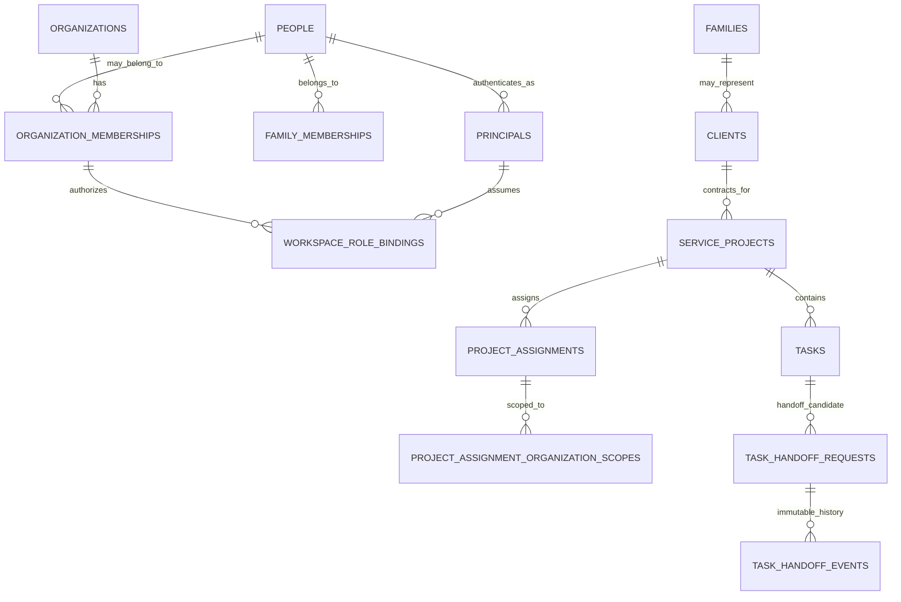

# Database Architecture V3.1 — measured DB-02 slice

**Status: PASS for isolated structure inspection; HOLD for deployment and full V3.1 business outcome.** The authoritative mainline is `phoenix/database/canonical/`, with formal 0001–0037 in the inspected main. The catalog evidence in this package is from disposable PG16/17 databases containing the 37 formal migrations and the isolated 0042/0043 candidates. This is not evidence that 0042/0043 run on any shared environment.

## Logical data map

The organization and workspace tables above are **0042 candidate** objects. The two task handoff tables are **0043 candidate** objects. Existing People, Family, Client, Project and Task rows remain the only master records. Commercial attribution (`crm.lead_attributions`, `crm.referrals`), sales assignment (`crm.sales_assignments`), project delivery assignment (`service.project_assignments`) and task assignee are distinct authorities. Neither an organization hierarchy nor a task transfer grants access to a whole client or student file.

## Actual catalog findings

| Checked property | PG16 | PG17 | Scope |
|---|---:|---:|---|
| Canonical ledger rows | 39 | 39 | 0001–0037, 0042, 0043 only; reserved numbers absent |
| Business tables | 102 | 102 | 13 schemas including identity and casework |
| Functions | 315 | 315 | catalog count, not all approved APIs |
| RLS policies | 92 | 92 | all inspected schemas |
| Tables with FORCE RLS | 68 | 68 | older tables are not uniformly forced |

The [per-table matrix](TABLE_REUSE_MATRIX.md) lists actual column, FK, UNIQUE, index and RLS counts. The two complete [catalog snapshots](evidence/pg16/catalog.json) and [PG17 catalog](evidence/pg17/catalog.json) preserve names and definitions. There is no generated Person, Family, Student, Principal or Client master table in 0043.

## DB-02 transaction contract

1. Trusted backend authenticates the person and selects a live 0042 Staff workspace. Browser-supplied role or organization is never an authority.
2. Its binder uses a one-use ticket; the restricted app connection redeems it. SQL checks the bound principal, role, organization and live session again.
3. A task's current assignee proposes a transfer to a principal already assigned to the same live project in the same organization. One task has at most one open proposal.
4. The named recipient accepts, rejects, or the sender cancels. Acceptance updates only `service.tasks.assigned_principal_id`, writes a `service.task_events` TRANSFERRED record and immutable handoff history in one transaction.
5. A rejection, cancellation or expired proposal leaves the task assignment unchanged. Replays are idempotent; a conflicting replay is refused. A project/role revoke blocks a new acceptance.

There is no HTTP write route in this package. The restricted inbox projection returns only live proposals in the current Staff organization, after checking that the actor still has a project assignment; it writes an access decision audit record. SQL EXECUTE is granted only to the restricted workspace reader role, with no direct table rights. Turning it into a user-facing API requires a separate trusted backend review, use-case authorization and product decision. The existing Family OS and Service Project API shapes are not changed.

## Unresolved architecture boundaries

- **HOLD:** CRM client or lead handoff, including original source, contact owner, marketing/Consent purpose, notifications and effective time. Existing rows can express some of these but no approved atomic transfer contract was found.
- **HOLD:** staff or partner access to student private documents; a task transfer does not create a document grant.
- **HOLD:** DB-03 study enrollment, rule occurrence and long-term followup, DB-04 cross-project documents/AI review, DB-05 ASKWISE evidence integration. Their design/gaps are documented without new SQL in this PR.
- **HOLD:** real identity provider, actual people/roles, controlled account mapping, nonproduction installation, production release and legacy database retirement.
